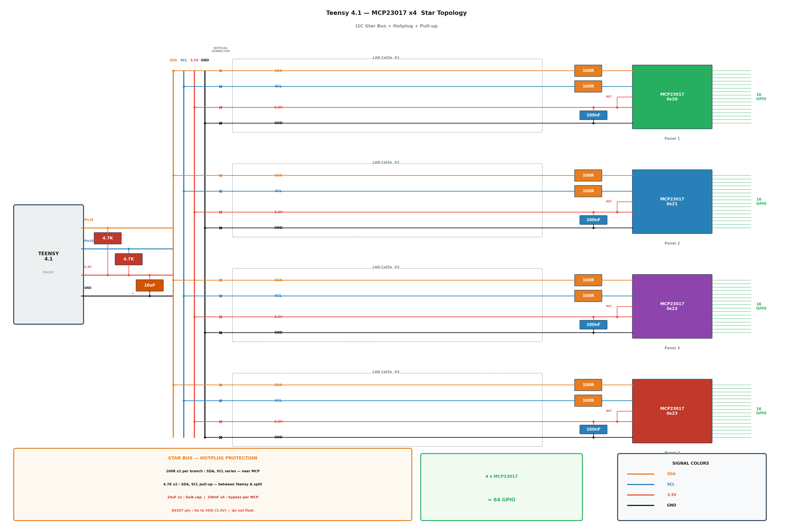

# REDKITE F16 PANELS


VR 전용 F-16 미니멀 데스크핏
**Falcon BMS**(BMS-BIOS)와 **DCS World**(DCS-BIOS) 자동 감지로 패널의 LED 연동

---

## 개요

VR 전용 미니멀 데스크핏을 지향합니다. VR 헤드셋을 쓰고 손을 뻗은 곳에 스위치가 있었으면 하는 생각을 1년 이상 참다가 결국 만들었습니다 ㅠㅠ 실기 1:1 스케일로 제작했습니다. 사용하지 않을 때 쉽게 치울 수 있는 이동식/수납식 구조를 대외적으로 표방(치울지는 모르겠음), 인게임 디스플레이로 충분한 계기류(DED, RWR, 엔진 게이지, HSI 등)는 제작하지 않고 스위치와 LED 위주로 구성했습니다.

### 주요 기능

- **PWM 백라이트 디밍** — MOSFET PWM으로 인게임 조명 노브에 연동되는 무단계 밝기 조절
- **USB Suspend 감지** — PC 절전 시 LED 소등 및 MCU 저전력 모드 진입
- **프로토콜 자동 감지** — BMS-BIOS / DCS-BIOS 자동 판별, LED·백라이트 연동
- **MCP23017 I2C 확장** — 새로운 패널을 I2C로 추가 가능. 핫플러그 지원
- **74HC595 시프트 레지스터** — ECM 32 LED를 3핀으로 구동
- **로터리 엔코더** — UHF 주파수 5자리 + PRESET을 6개 엔코더로 구현 (1kHz ISR)
- **DCS 커버 자동화** — ENG CONT, EPU 스위치 조작 시 커버를 자동으로 열고 닫음

### 디바이스 구성

독립된 USB 디바이스 2대. 각각 별도의 Teensy 4.1과 스케치를 사용합니다.

| 디바이스 | 폴더 | PID | 담당 |
|---|---|---|---|
| **Left Aux + MISC** | `F16_LEFT_AUX_MISC/` | `0x0489` | Gear, CMDS, TWA, Alt Gear, MISC, HMCS, Pedal |
| **Left Console** | `F16_LEFT_CONSOLE/` | `0x048E` | ECM, ELEC, EPU, AVTR, UHF, ENGINE START, MPO, AUDIO 1/2 |

#### Left Aux + MISC (`0x0489`) — DX 51, 축 4

| Panel | Type | Description |
|-------|------|-------------|
| Gear | Switch, LED | Landing Gear, Hook, Anti-skid, Landing Light, Gear Warning 등 |
| Alt Gear | Switch | ALT Gear Handle |
| MISC | Switch, LED (MCP23017) | Master ARM, Laser ARM, RF, Autopilot Pitch/Roll, ECM LED 등 |
| CMDS | Switch, Analog Ladder, LED | RWR, JMR, MWS, JETT, MODE (7-pos), PRGM (7-pos), GO/NO GO/RDY EWS 램프 |
| TWA | Analog Ladder, LED | Threat Warning Aux — Search, Act/Pwr, Low, Power |
| HMCS | Analog | Symbology 포텐셔미터 |
| Pedal | Analog | Rudder + Left/Right Brake (auto calibration) |

#### Left Console (`0x048E`) — DX 58, 축 10

| Panel | Type | Description |
|-------|------|-------------|
| ECM | Switch (MCP23017), Analog Ladder, LED (74HC595) | OPR/STBY, XMIT, BIT, RESET + 8버튼 래더 + S/A/F/T 32 LED |
| ELEC | Switch, LED (MCP23017) | MAIN PWR, CAUTION RST + 경고등 8개 |
| EPU | Switch (MCP23017) | OFF / NORM / ON |
| AVTR | Switch (MCP23017) | OFF / AUTO / ON |
| UHF | Switch, Encoder ×6, Analog | FUNCTION(4), MODE(3), SQUELCH, T-TONE, STATUS + 주파수 엔코더 + VOL |
| ENGINE START | Switch | JFS, ENG CONT, MAX PWR, AB RESET, ENG DATA |
| MPO | Switch | Manual Pitch Override |
| AUDIO 1/2 | Analog, Switch (MCP23017) | 볼륨 6개 + COMM 1/2 모드 로터리 2개 |

DCS에서는 ENG CONT, EPU 커버 자동화용 DX 3개(59~61)가 추가됩니다.

---

## 1. 준비물

### 1-1. 패널

콕핏 빌더 전문 업체에서 구매하거나 3D 프린터로 직접 출력할 수 있습니다.

**구매처:**
- [PC Flights](https://pcflights.com/flight-simulator-cockpit-panels/f-16c-viper-home-cockpit-panels/) — F-16C 패널 전문 **(본 프로젝트에서 사용)**
- [HispaPanel](https://hispapanels.com/tienda/en/20-f-16-fighting-falcon) — 레이저 커팅/각인 패널 키트
- [TEK Creations](https://tekcreations.space/shop/) — LED 백라이트 패널, DCS-BIOS 레디

| MISC | Gear | CMDS |
|:----:|:----:|:----:|
| [](https://pcflights.com/f-16c-viper-miscellaneous-misc-panel-flight-sim-part/) | [](https://pcflights.com/f-16c-viper-landing-gear-panel-flight-simulator-module/) | [](https://pcflights.com/f-16c-viper-cmds-control-panel-module/) |

**3D 프린트 모델:**
- [Greenisland](https://cults3d.com/en/users/Greenisland/3d-models) — F-16 콕핏 거의 전체 파트
- [Legarsdusofa](https://cults3d.com/en/design-collections/Legarsdusofa/f-16-cockpit-simulator) — F-16 콕핏 거의 전체 파트
- [The_Viper_Project](https://cults3d.com/en/users/The_Viper_Project/3d-models) — 버튼 노브, 스위치 캡 등 무료

### 1-2. 인클로저 & 스탠드

`docs/3d stl/` 폴더에 STL 파일이 있습니다. PETG 권장 (JLC3DP는 PETG 미지원, PCBWay 별도 주문).
Stand는 Enclosure 뒷면에 에폭시 접착제로 부착합니다. new 버전 권장.

| Left Stand | Left Stand (new) | Right Stand | Right Stand (new) |
|:----:|:----:|:----:|:----:|
| <a href="docs/3d%20stl/Left%20Stand.stl"></a> | <a href="docs/3d%20stl/Left%20Stand%20-%20new.stl"></a> | <a href="docs/3d%20stl/Right%20Stand.stl"></a> | <a href="docs/3d%20stl/Right%20Stand-%20new.stl"></a> |

| Left Enclosure | Right Enclosure (new) | Enclosure OnePiece |
|:----:|:----:|:----:|
|  |  | <a href="docs/3d%20stl/Enclosure%20-%20%20OnePiece2.stl"></a> |

> Left/Right Enclosure STL은 Cults3D 구매 모델 기반이라 저작권 보호를 위해 재배포하지 않습니다.

### 1-3. MCU

[Teensy 4.1](https://www.pjrc.com/store/teensy41.html) × 2대. 선택 이유:
- USB 조이스틱 128버튼 네이티브 지원 (Arduino Mega 등은 USB HID 미지원)
- 600MHz ARM Cortex-M7 — 다중 작업에 충분한 성능
- 42 GPIO + 하단 SD 패드 — 충분한 핀 수

### 1-4. 부품 목록

**스위치류**

| 부품 | 수량 | 비고 |
|------|------|------|
| 토글 스위치 On-Off-On (12mm, 3P) | 20 | |
| 토글 스위치 On-On (12mm, 3P) | 20 | |
| 푸시 스위치 7mm (PBS-110) | 12 | |
| 모멘터리 푸시 스위치 6mm (3핀) | 5 | |
| 택타일 스위치 SMD (6x6x4.3mm) | 20 | |
| 리밋 스위치 (12x6mm) | 10 | |
| 로터리 스위치 SR26 1P12T | 4 | |
| 로터리 스위치 RS16 1P6T / 1P5T | 2 / 2 | |
| 포텐셔미터 10kΩ | 10 | |
| 코리 스위치 | 1 | [HispaPanel](https://hispapanels.com/tienda/en/buttons-encoders/71-korry-type-tactile-switch-momentary.html) |
| 키보드 스위치 (Brown) | 2 | |

**IC / 반도체**

| 부품 | 수량 | 비고 |
|------|------|------|
| MCP23017 I2C I/O Expander | 4 | AUX: MISC `0x20` / 콘솔: UHF+AUDIO `0x20`, ELEC+EPU `0x21`, ECM+AVTR `0x22` |
| 74HC595 시프트 레지스터 | 4 | ECM 패널 32 LED 구동 (데이지체인) |
| IRLML6244 N-ch MOSFET | 2+ | 백라이트 PWM 스위칭 |
| 로터리 엔코더 EC11 (디텐트) | 6 | UHF — PRESET은 20디텐트 권장 |

**LED**

| 부품 | 수량 | 비고 |
|------|------|------|
| 3mm LED Green (백라이트용) | 100 | 고휘도 |
| LED 키트 3mm/5mm Mixed | 300 | Red, Green, Yellow (인디케이터) |

**수동 소자**

| 부품 | 수량 | 비고 |
|------|------|------|
| 1/4W 저항 (1K, 4.7K, 10K, 100Ω, 150Ω, 220Ω) | 각 100 | 래더, 풀다운, 풀업 |
| SMD 1206 저항 (220Ω, 2.2K, 10K) | 각 100 | |
| 전해 커패시터 25V (10µF / 100µF) | 각 40 | 바이패스 |
| 세라믹 커패시터 (100nF / 1nF) | 각 100 | 바이패스 |

**커넥터 / 배선**

| 부품 | 수량 | 비고 |
|------|------|------|
| 실리콘 와이어 22AWG 5색 | 50m | |
| Dupont 커넥터 & 점퍼선 | 다수 | 쉘, 핀, F-F 점퍼 |
| Spade 압착 터미널 2.8mm | 200쌍 | 토글 스위치 연결 |
| Pin Header 1x30P | 10 | |
| 수축 튜브 | 750 | |

**모듈 / 기타**

| 부품 | 수량 | 비고 |
|------|------|------|
| 12V DC 어댑터 (1A) | 2 | 백라이트 전용 (AUX 1 + 콘솔 1). Step-Up은 래더 ADC 노이즈 유발 |
| RJ45 패널 마운트 커넥터 / 키스톤 잭 | 7+ | I2C, 엔코더, 아날로그 신호 케이블 |
| Cat5e LAN 케이블 | 7+ | 신호 배선용 |

### 1-5. 소요 비용

| 유형 | 업체 | 내용 | 제품 (USD) | 배송 (USD) |
|------|------|------|----:|----:|
| 패널 | [PC Flights](https://pcflights.com) | MISC / Gear / CMDS 패널 3종 | $133 | $31 |
| 3D 프린트 (SLA/MJF) | [JLC3DP](https://jlc3dp.com) | 스위치 캡, 노브, LED 레이어 등 | $64 | $20 |
| 3D 프린트 (PETG) | [PCBWay](https://www.pcbway.com) | Enclosure, Stand 등 구조물 | $119 | ~$50 |
| MCU | [PJRC](https://www.pjrc.com) | Teensy 4.1 ×2 | ~$70 | - |
| 전자부품 | [AliExpress](https://www.aliexpress.com) | MCP23017, 스위치, LED, 저항 등 | ~$200 | - |
| 노동력 | - | 약 1달간의 설계, 조립, 프로그래밍 | priceless | - |
| | | **합계** | **~$586** | **~$101** |

> 결론: 시간과 노동력을 고려하면 TEK Creations 등 완제품을 사는 게 현명합니다. 직접 만드는 건 취미입니다.

---

## 2. 개발 환경 설정

### 2-1. Arduino IDE 설치

1. [Teensyduino](https://www.pjrc.com/teensy/td_download.html) 설치
2. Arduino IDE에서:
   - **Board**: Teensy 4.1
   - **USB Type**: Serial + Keyboard + Mouse + Joystick

### 2-2. usb_desc.h 수정 (Extreme Joystick)

AUX 51버튼, 콘솔 58버튼이므로 **두 스케치 모두** 128버튼 Extreme 모드가 필요합니다.

파일 위치: `%LOCALAPPDATA%\Arduino15\packages\teensy\hardware\avr\<version>\cores\teensy4\usb_desc.h`

```c
#define JOYSTICK_SIZE         64    //  12 = normal, 64 = extreme joystick
#define PRODUCT_ID            0x0489  // AUX 보드 / 콘솔 보드는 0x048E
```

두 보드가 `JOYSTICK_SIZE 64`를 공유하므로 빌드 사이에 이 값을 고칠 필요는 없습니다. **`PRODUCT_ID`만 디바이스에 맞게** 바꿔 빌드합니다. 값이 틀리면 각 스케치의 `#error`가 빌드를 막아줍니다.

> **축은 6개가 아니라 23개입니다.** Extreme 모드는 명명 축 6개(X/Y/Z/Xrotate/Yrotate/Zrotate)에 더해 `Joystick.slider(1..17)`을 제공합니다. 단, Windows DirectInput은 최대 8축만 인식하므로, `usb_desc.c`에서 Report Count를 8로 줄이고 나머지는 constant padding 처리가 필요합니다. 상세는 [docs/LEFT_CONSOLE_PIN_TREE.md](docs/LEFT_CONSOLE_PIN_TREE.md)의 「usb_desc.c 수정 사항」 참조.

> Teensyduino 업데이트 시 `usb_desc.h`와 `usb_desc.c`가 덮어씌워집니다. 업데이트 전에 백업하거나, 업데이트 후 다시 수정하세요. 상세는 [docs/teensyduino_upgrade.md](docs/teensyduino_upgrade.md) 참조.

---

## 3. 배선

### 3-1. 핀 배치 문서

각 보드의 전체 핀 배열, DX 버튼 맵, MCP GPIO 맵, 케이블 배선 상세, 시공 체크리스트가 아래 문서에 있습니다. **배선 전에 반드시 읽으세요.**

| 보드 | 핀 배치 문서 |
|---|---|
| Left Aux + MISC | [docs/LEFT_AUX_PIN_TREE.md](docs/LEFT_AUX_PIN_TREE.md) |
| Left Console | [docs/LEFT_CONSOLE_PIN_TREE.md](docs/LEFT_CONSOLE_PIN_TREE.md) |

스위치 배선은 전부 **액티브 로우 + INPUT_PULLUP** (공통 단자 = GND, 눌림 = LOW = ON).

### 3-2. 저항 래더

로터리 스위치(CMDS MODE, CMDS PRGM)와 TWA 버튼은 각각 아날로그 핀 1개에 저항 래더로 연결합니다. 핀 1개로 여러 버튼을 처리할 수 있어 핀 절약에 효과적입니다.

**AUX 보드 래더 (1kΩ 체인 + 4.7kΩ 풀다운):**
- 각 포지션마다 1kΩ 직렬 저항으로 고유 ADC 값 생성
- ADC 값 = `1023 × 4700 / (k × 1000 + 4700)`
- 사용 핀: A10 (TWA 4버튼), A11 (CMDS MODE 7포지션), A12 (CMDS PRGM 7포지션)

**콘솔 보드 ECM 래더 (10kΩ 체인 + 20kΩ 풀다운):**
- PCB가 이미 제작되어 저항값 고정, 8단이라 상위 값 간격이 좁음 (FRM 253 / SPL 225 = 28카운트)
- tolerance 창 대신 **최근접값(nearest-value)** 판별 + 8회 오버샘플링
- 사용 핀: A14 (ECM 8버튼)

> `ALLOW_DEBUG = true`로 시리얼 모니터에서 실제 analogRead 값을 확인하고 values[] 배열을 캘리브레이션하세요.

### 3-3. MCP23017 I2C 확장

Teensy의 직결 핀은 모두 사용 중이므로, 추가 스위치/LED는 MCP23017 I2C 확장으로 추가합니다.

- MCP23017 하나당 16핀 (GPA0–7, GPB0–7)
- I2C 주소: A0~A2 핀으로 설정, 최대 8개 (0x20~0x27)
- **AUX 보드**: 1장 (`0x20` = MISC), Star 토폴로지
- **콘솔 보드**: 3장 (`0x20` `0x21` `0x22`), 데이지체인 토폴로지

**I2C 핫플러그 보호 (양쪽 공통):**
- SDA/SCL 각 100Ω 직렬 저항 (MCP 입력단) — 돌입전류 제한
- 4.7kΩ × 2 I2C 풀업 저항 (AUX) / 모듈 온보드 4.7kΩ × 3 병렬 (콘솔)
- 10µF + 100nF 바이패스 캡 — MCP23017 VDD 전압 스파이크 흡수
- MOSFET Gate 10kΩ 풀다운 — 핫플러그 시 OFF 유지



AUX↔MISC 패널 LAN 배선 상세: [docs/LEFT_AUX_MISC_LAN_WIRING.md](docs/LEFT_AUX_MISC_LAN_WIRING.md)

### 3-4. 백라이트

양쪽 보드 모두 **MOSFET PWM 디밍**을 지원합니다. Teensy pin 13으로 MOSFET을 PWM 제어하며, 인게임 조명 노브에 연동됩니다.

**회로:**

```
12V ─── LED strips (3 LED + 220Ω 직렬) ─── LED-RTN
                                               │
                                             Drain
                                               │
                                            MOSFET (IRLML6244, N-ch)
                                               │
                                             Source
                                               │
                                              GND ── 12V adapter GND ═══ Teensy GND (단일점!)
                                             Gate
                                              ├──┤1kΩ├── Teensy pin 13
                                              │
                                             10kΩ
                                              │
                                             GND
```

**전원:**

| 보드 | 전원 | 비고 |
|---|---|---|
| **AUX** | 별도 12V DC 어댑터 | Step-Up 5V→12V는 래더 ADC에 노이즈 유발하여 어댑터로 변경 |
| **콘솔** | 별도 12V DC 어댑터 | LED 40개로 USB 예산 초과 |

**양쪽 모두 어댑터 GND ↔ Teensy GND를 단일점(star)으로 반드시 연결하세요.** MOSFET Gate 기준이 없으면 백라이트가 동작하지 않습니다.

**밝기 제어:**

| 상태 | 동작 |
|---|---|
| BMS online | 브릿지가 `instrLight` → `ledBits` byte 2로 brightness 0~255 전송 |
| DCS online | Teensy가 `LIGHT_INST_PNL`(0x4484) 0~65535 → >>8 → PWM 0~255 직접 변환 |
| Offline 수동 (AUX) | DN LOCK REL 누른 채 HMCS Symbology pot(A15)로 밝기 조절 (방향 반전) |
| Offline 수동 (콘솔) | UHF STATUS 누른 채 UHF VOL pot(A9)로 밝기 조절 |
| Idle 30분 | 자동 꺼짐. 아무 입력으로 복귀 |
| USB Suspend | LED + 백라이트 소등, MCU 절전 |

**LED 배치:**
- PC Flights 패널은 2중 구조 (전면: 검정 도색 + 흰색 각인 / 후면: 투명)
- 후면 투명 패널 뒤쪽 1~2cm 간격에서 LED를 쏘면 전면 각인 글자가 빛남
- LED 3개 + 220Ω 저항 1개 = 직렬 스트링, 최대 15스트링 병렬 (총 45 LED)


---

## 4. 펌웨어 업로드

Arduino IDE에서 해당 `.ino`를 열고 Upload합니다. `usb_desc.h`의 `PRODUCT_ID`가 보드와 일치하는지 먼저 확인하세요.

| 보드 | 파일 | PRODUCT_ID |
|---|---|---|
| Left Aux + MISC | `F16_LEFT_AUX_MISC/F16_LEFT_AUX_MISC.ino` | `0x0489` |
| Left Console | `F16_LEFT_CONSOLE/F16_LEFT_CONSOLE.ino` | `0x048E` |

라이브러리는 `Wire`, `Keyboard` (모두 built-in)만 필요합니다.

---

## 5. 소프트웨어 설정 (Python 브릿지)

스위치 입력은 USB Joystick으로 직접 전달되지만, **LED 상태는 시뮬레이터에서 받아와야 합니다.** Python 브릿지가 시뮬레이터 데이터를 읽어 시리얼로 Teensy에 전송합니다.

```bash
pip install pyserial hidapi
```

- `pyserial` — Teensy 시리얼 통신 (필수)
- `hidapi` — Cougar MFD 백라이트 동기화 (선택, 없으면 MFD 건너뜀)

### Falcon BMS (BMS-BIOS)

```bash
python tools/bmsbios_bridge.py                          # 두 디바이스 자동 감지
python tools/bmsbios_bridge.py COM4:AUX COM5:CONSOLE    # 수동 지정
python tools/bmsbios_bridge.py --debug                  # LightBits 실시간 출력
```

- `0xAA 0xBB` sync로 자동 감지
- BMS 공유 메모리에서 LED 상태를 읽어 Teensy로 전송
- 프레임: `sync(2) + ledBits(4) + srData(4) + uhfFreq(4) + uhfPreset(1) + XOR(1)` = 16바이트
- Cougar MFD 연결 시 `instrLight`에 따라 백라이트 자동 동기화
- BMS 실행 전에 bridge를 먼저 실행해도 안전

### DCS World (DCS-BIOS)

```bash
python tools/dcsbios_bridge.py    # COM port auto-detect
```

- `0x55 ×4` sync로 자동 감지
- [DCS-BIOS](https://github.com/DCS-Skunkworks/dcs-bios) 설치 필요

### 프로토콜 자동 감지

Teensy는 수신된 sync 바이트로 BMS/DCS 프로토콜을 자동 판별합니다. 타임아웃(AUX 6초 / 콘솔 3초) 후 프로토콜을 리셋하고 재감지합니다.

**오프라인(브릿지 미연결) 동작:**
- AUX 보드: Landing Gear 스위치 상태에 따라 Gear LED 3개를 시뮬레이션 (2초 딜레이 + Gear Warn 5초)
- 콘솔 보드: 모든 LED 소등

---

## 6. 테스트 & 캘리브레이션

### 6-1. 조이스틱 확인

Windows `joy.cpl`은 32버튼까지만 표시합니다. 128버튼을 확인하려면 [VKB DevCfg](https://vkbcontrollers.com/?page_id=4609) 또는 [Joystick Gremlin](https://whitemagic.github.io/JoystickGremlin/)을 사용하세요.

### 6-2. 래더 캘리브레이션

1. `F16_LEFT_AUX_MISC.ino` 또는 `F16_LEFT_CONSOLE.ino`에서 `ALLOW_DEBUG = true` 설정
2. 업로드 후 시리얼 모니터(1000000 baud)에서 각 포지션의 ADC 값 확인
3. `values[]` 배열을 실측값으로 업데이트
4. `ALLOW_DEBUG = false`로 복원 후 재업로드

### 6-3. 페달 캘리브레이션

페달은 자동 캘리브레이션을 지원합니다.
- **리셋**: 양 페달 최대 압력 + DN LOCK REL 2초간 홀드
- **브레이크 모드 전환**: Landing Light UP 또는 양 페달 동시 압력

### 6-4. 엔코더 방향 확인

UHF 엔코더의 CW/CCW가 반대면 `encoders[]`의 `pinA`/`pinB`를 교체하세요.

---

## 커스터마이징

스위치/LED 등 하드웨어 변경 시 각 `.ino`의 **HARDWARE CONFIGURATION** 섹션의 config 배열만 수정합니다. 조이스틱 버튼 번호는 런타임에 자동 재할당됩니다.

| 배열 | 용도 | 보드 |
|---|---|---|
| `switches[]` | 디지털 스위치 (직결 / MCP) | 공통 |
| `analogBtnArrays[]` | 저항 래더 그룹 | 공통 |
| `mcpDevices[]` | MCP23017 I2C 주소 | 공통 |
| `leds[]` | LED (직결 / MCP) | 공통 |
| `pots[]` | 포텐셔미터 → 조이스틱 축 | 공통 |
| `encoders[]` | 로터리 엔코더 | 콘솔 |
| `srMap[]` | 74HC595 논리→물리 출력 리맵 | 콘솔 |

```cpp
// 스위치 추가 예시 (mcpIdx: -1=Teensy직결, 0+=MCP 인덱스)
{"My Switch",   PNL_GEAR,  SW_ON_OFF,  -1,  5,  0,  NULL},
{"MCP Switch",  PNL_MISC,  SW_ON_OFF,   0,  5,  0,  NULL},  // mcpIdx=0, GPA5
```

새 MCP 디바이스를 추가하려면 `mcpDevices[]`에 I2C 주소를 등록하면 됩니다. 패널을 비활성화하려면 해당 항목을 주석 처리하면 됩니다.

---

## Left Console 보드 상세

콘솔 보드(`F16_LEFT_CONSOLE/`)는 AUX 보드 대비 몇 가지 고유 사항이 있습니다.

**로터리 엔코더 (UHF 6개)**
1kHz `IntervalTimer` ISR에서 쿼드러처를 디코딩하고, 메인 루프가 CW/CCW DX 버튼 펄스로 배출합니다. 엔코더는 **MCP23017에 올릴 수 없습니다** — I2C 폴링으로는 펄스를 놓칩니다.

**UHF 7세그 디스플레이 (MAX7219)**
UHF 주파수 6자리 + 채널 2자리를 표시합니다. DCS에서는 DCS-BIOS가 디스플레이 상태를 직접 제공하므로 UHF OFF 시 자동으로 꺼집니다. BMS 공유 메모리에는 UHF FUNCTION 스위치 상태가 없어서, 펌웨어가 물리 스위치(FUNCTION=OFF) 위치를 직접 읽어 디스플레이를 끕니다. 브릿지 미연결 시에도 번인 방지를 위해 디스플레이가 꺼집니다.

**74HC595 32/32 소진**
칩을 추가하면 BMS-BIOS 프레임의 `srData` 32비트를 넘으므로 `BB_FRAME_PAYLOAD`, 양쪽 `BmsBiosParser.h`, `bmsbios_bridge.py`를 모두 수정해야 합니다.

**I2C 데이지체인**
AUX의 Star와 달리 MCP 3장을 한 줄로 체인합니다. 한 링크가 끊기면 하류 전체가 사라지는 대신, 분기 스터브가 없어 반사가 줄고 총 배선이 짧아집니다.

**별도 12V 어댑터**
인디케이터 LED 40개(ECM 32 + ELEC 8)로 USB 전력 예산을 초과합니다. **어댑터 GND와 Teensy GND를 단일점으로 반드시 연결하세요.**

상세는 [docs/LEFT_CONSOLE_PIN_TREE.md](docs/LEFT_CONSOLE_PIN_TREE.md) 참조.

---

## 프로젝트 구조

```
REDKITE-F16-Panels/
├── F16_LEFT_AUX_MISC/             # Teensy 4.1 (PID 0x0489)
│   │                              #   Gear, CMDS, TWA, Alt Gear, MISC, HMCS, Pedal
│   ├── F16_LEFT_AUX_MISC.ino
│   ├── BiosHandler/               # DcsBiosParser.h / BmsBiosParser.h
│   ├── CLAUDE.md
│   └── name.c
├── F16_LEFT_CONSOLE/              # Teensy 4.1 (PID 0x048E)
│   │                              #   ECM, ELEC, EPU, AVTR, UHF,
│   │                              #   ENGINE START, MPO, AUDIO 1/2
│   ├── F16_LEFT_CONSOLE.ino
│   ├── BiosHandler/
│   ├── Display/                   # Max7219Display.h (UHF 7-seg)
│   ├── CLAUDE.md
│   └── name.c
├── tools/                         # Python 브릿지 (BMS/DCS → Teensy)
│   ├── bmsbios_bridge.py          #   VID/PID로 두 디바이스 동시 인식
│   ├── dcsbios_bridge.py
│   ├── reset_joystick_name.bat
│   └── backup_to_synology.ps1
├── docs/                          # 배선도, 핀 트리, 프로토콜 참조
│   ├── LEFT_AUX_PIN_TREE.md       #   AUX 보드 핀 트리·배선·DX맵
│   ├── LEFT_CONSOLE_PIN_TREE.md   #   콘솔 보드 핀 트리·배선·DX맵·전원
│   ├── LEFT_AUX_MISC_LAN_WIRING.md #  AUX↔MISC LAN 배선도
│   └── 3d stl/                    #   3D 프린트용 STL 파일
├── CLAUDE.md                      # Claude Code 가이드
└── README.md
```

## 7. 프로토콜 레퍼런스

### 7-1. DCS-BIOS (DCS World F-16C_50)

**Source:** DCS-BIOS `F-16C_50.json`
- 로컬: `%USERPROFILE%\Saved Games\DCS\Scripts\DCS-BIOS\doc\json\F-16C_50.json`
- 웹: http://localhost:5010/reference/ (DCS 실행 중)

**Protocol:**
- Binary, sync `0x55` ×4
- 반복 청크: `ADDR_LO ADDR_HI COUNT_LO COUNT_HI DATA[count]`
- 프레임 종료: addr=0x5555, count=0x5555
- Baud: 1,000,000

**LED Address Map** (DcsBiosParser.h):

| Identifier | Addr(hex) | Mask | Bit | Description |
|---|---|---|---|---|
| LIGHT_GEAR_N | 0x447A | 0x4000 | 14 | Nose Gear (green) |
| LIGHT_GEAR_L | 0x447A | 0x8000 | 15 | Left Gear (green) |
| LIGHT_GEAR_R | 0x447C | 0x0001 | 0 | Right Gear (green) |
| LIGHT_GEAR_WARN | 0x447C | 0x0002 | 1 | Gear Warning (red) |
| LIGHT_RWR_SEARCH | 0x447E | 0x0400 | 10 | TWA Search |
| LIGHT_RWR_ACTIVITY | 0x447E | 0x0800 | 11 | TWA Activity |
| LIGHT_RWR_ACT_POWER | 0x447E | 0x1000 | 12 | TWA Act/Power |
| LIGHT_RWR_ALT_LOW | 0x447E | 0x2000 | 13 | TWA Alt Low |
| LIGHT_ECM | 0x4544 | 0x4000 | 14 | ECM Indicator |
| LIGHT_INST_PNL | 0x4484 | 0xFFFF | - | Instrument Panel Lighting (0–65535) |

**ECM LED Address Map** (74HC595, 32 outputs):

| Addr(hex) | Bits | LEDs |
|---|---|---|
| 0x4480 | 13–15 | ECM 1 S/A/F |
| 0x448A | 0–15 | ECM 1T, 2–5 S/A/F/T |
| 0x448C | 0–12 | ECM 5T, 6 S/A/F/T, FRM S/A/F/T, SPL S/A/F/T |

**UHF Display** (string outputs):

| Identifier | Addr(hex) | Type | Length | Description |
|---|---|---|---|---|
| UHF_CHAN_DISP | 0x45B0 | string | 2 | UHF Channel Display (" 1"~"20") |
| UHF_FREQ_DISP | 0x45B2 | string | 7 | UHF Manual Frequency Display ("305.000") |

### 7-2. BMS-BIOS (Falcon BMS 4.38)

**Source:** `C:\Falcon BMS 4.38\Tools\SharedMem\FlightData.h`

**Protocol:**
- Binary, sync `0xAA 0xBB`
- Payload 13바이트:
  - `ledBits` (uint32 LE, 4B) — bits 0–11: LED states, bits 16–23: backlight PWM
  - `srData` (uint32 LE, 4B) — ECM 시프트 레지스터 32비트
  - `uhfFreq` (uint32 LE, 4B) — UHF 주파수 (kHz)
  - `uhfPreset` (uint8, 1B) — UHF 프리셋 채널 (1–20)
- Checksum: XOR of 13 payload bytes (1B)
- Total: **16 bytes** per frame (sync 2 + payload 13 + checksum 1)
- Baud: 1,000,000

**Shared Memory:**

| 영역 | 오프셋 | 타입 | 필드 | 설명 |
|---|---|---|---|---|
| FalconSharedMemoryArea | 108 | uint | lightBits | LED 상태 비트맵 |
| | 124 | uint | lightBits2 | LED 상태 비트맵 2 |
| | 128 | uint | lightBits3 | LED 상태 비트맵 3 |
| FalconSharedMemoryArea2 | 1104 | uchar | instrLight | 백라이트 (0=OFF, 1=DIM, 2=BRT) |
| | 48 | int | uhf_panel_preset | UHF 채널 프리셋 |
| | 52 | int | uhf_panel_frequency | UHF 주파수 (kHz) |
| | 1180 | uint[5] | ecmBits | ECM 프로그램 상태 ×5 |

**LightBits Mask Map** (bmsbios_bridge.py):

LightBits (offset 108):

| Name | Mask | Bit | Description |
|---|---|---|---|
| AdvStandby | 0x80000000 | 31 | ADV Standby indicator |

LightBits2 (offset 124):

| Name | Mask | Bit | Description |
|---|---|---|---|
| AuxSrch | 0x00001000 | 12 | TWA Search |
| AuxAct | 0x00002000 | 13 | TWA Activity |
| AuxLow | 0x00004000 | 14 | TWA Alt Low |
| AuxPwr | 0x00008000 | 15 | TWA Power |
| EcmPwr | 0x00010000 | 16 | ECM power indicator |
| EPUOn | 0x00100000 | 20 | EPU RUN light |
| JFSOn | 0x00200000 | 21 | JFS RUN light |
| AdvActive | 0x20000000 | 29 | ADV Active indicator |
| GEARHANDLE | 0x40000000 | 30 | Gear handle lamp |

LightBits3 (offset 128):

| Name | Mask | Bit | Description |
|---|---|---|---|
| FlcsPmg | 0x00000001 | 0 | FLCS PMG |
| MainGen | 0x00000002 | 1 | MAIN GEN |
| StbyGen | 0x00000004 | 2 | STBY GEN |
| EpuGen | 0x00000008 | 3 | EPU GEN |
| EpuPmg | 0x00000010 | 4 | EPU PMG |
| ToFlcs | 0x00000020 | 5 | BATT TO FLCS |
| FlcsRly | 0x00000040 | 6 | FLCS RLY |
| BatFail | 0x00000080 | 7 | BATT FAIL |
| Hydrazine | 0x00000100 | 8 | EPU HYDRAZN |
| Air | 0x00000200 | 9 | EPU AIR |
| NoseGearDown | 0x00010000 | 16 | Nose gear down and locked |
| LeftGearDown | 0x00020000 | 17 | Left gear down and locked |
| RightGearDown | 0x00040000 | 18 | Right gear down and locked |

### 7-3. LED Index Mapping — Left Aux + MISC (0x0489)

| Index | Name | Pin | Location | DCS-BIOS | BMS LightBit |
|---|---|---|---|---|---|
| 0 | Nose Gear | 30 | direct | 0x447A bit14 | LB3 NoseGearDown |
| 1 | Left Gear | 31 | direct | 0x447A bit15 | LB3 LeftGearDown |
| 2 | Right Gear | 32 | direct | 0x447C bit0 | LB3 RightGearDown |
| 3 | Gear Warn | 12 | direct | 0x447C bit1 | LB2 GEARHANDLE |
| 4 | TWA Power | 34 | direct | 0x447E bit12 | LB2 AuxPwr |
| 5 | TWA Low | 35 | direct | 0x447E bit13 | LB2 AuxLow |
| 6 | TWA Search | 36 | direct | 0x447E bit10 | LB2 AuxSrch |
| 7 | TWA Act | 37 | direct | 0x447E bit11 | LB2 AuxAct |
| 8 | ECM | MCP0:7 | MCP 0x20 | 0x4544 bit14 | LB2 EcmPwr |
| 9 | ADV Active | MCP0:8 | MCP 0x20 | 0x447E bit2 | LB2 AdvActive |
| 10 | ADV Standby | MCP0:9 | MCP 0x20 | 0x447E bit3 | LB AdvStandby |

### 7-4. LED Index Mapping — Left Console (0x048E)

| ledBits | Name | Location | BMS LightBit | DCS-BIOS |
|---|---|---|---|---|
| 0 | FLCS PMG | MCP 0x21 PA0 | LB3 FlcsPmg 0x00000001 | 0x447C bit9 |
| 1 | MAIN GEN | MCP 0x21 PA1 | LB3 MainGen 0x00000002 | 0x447C bit10 |
| 2 | STBY GEN | MCP 0x21 PA2 | LB3 StbyGen 0x00000004 | 0x447C bit11 |
| 3 | EPU GEN | MCP 0x21 PA3 | LB3 EpuGen 0x00000008 | 0x447C bit13 |
| 4 | EPU PMG | MCP 0x21 PA4 | LB3 EpuPmg 0x00000010 | 0x447C bit14 |
| 5 | FLCS RLY | MCP 0x21 PA5 | LB3 FlcsRly 0x00000040 | 0x447E bit0 |
| 6 | BATT FAIL | MCP 0x21 PA6 | LB3 BatFail 0x00000080 | 0x447E bit1 |
| 7 | BATT TO FLCS | MCP 0x21 PA7 | LB3 ToFlcs 0x00000020 | 0x447C bit15 |
| 8 | EPU HYDRAZN | MCP 0x22 GPA7 | LB3 Hydrazine 0x00000100 | 0x447C bit6 |
| 9 | EPU AIR | MCP 0x21 PB4 | LB3 Air 0x00000200 | 0x447C bit7 |
| 10 | EPU RUN | MCP 0x22 GPA7 | LB2 EPUOn 0x00100000 | 0x447C bit8 |
| 11 | JFS RUN | Teensy pin 26 | LB2 JFSOn 0x00200000 | 0x447C bit5 |

Backlight: `ledBits` byte 2 (bits 16–23) = PWM brightness. Bridge: `instrLight` 0→OFF, 1→DIM(255 or 50), 2→BRT(255). Offline 수동 조절: UHF STATUS + UHF VOL pot.

`srData`: uint32, ECM 32 LED (74HC595). FlightData2 `ecmBits[5]`에서 생성.

### 7-5. 프로토콜 자동 감지

Teensy는 수신된 sync 바이트로 프로토콜을 자동 판별합니다:
- `0x55` ×4 연속 → **DCS-BIOS**
- `0xAA` → `0xBB` → **BMS-BIOS**
- 타임아웃 (AUX 6초 / 콘솔 3초) → UNKNOWN으로 리셋, 재감지

---

## License

This project is licensed under the [MIT License](LICENSE).
