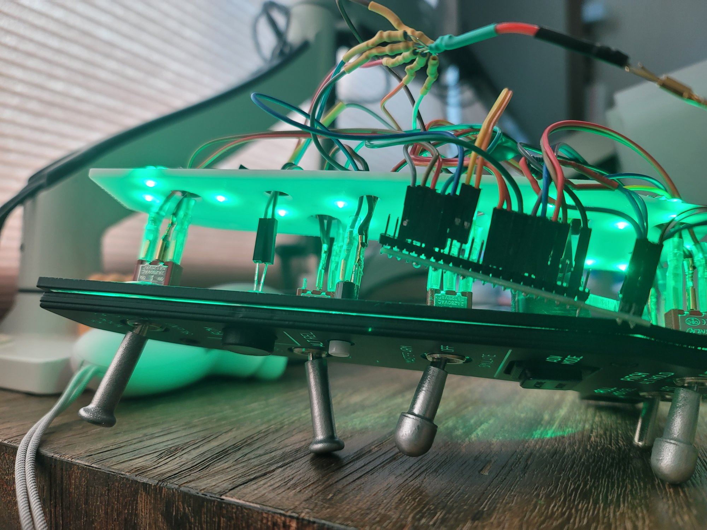

# 백라이트

양쪽 보드 모두 **MOSFET PWM 디밍**을 씁니다. 인게임 조명 노브에 연동되며,
채널은 두 가지입니다:

- **Pin 13 — console backlight**: AUX 로컬 패널(Gear/CMDS/TWA/HMCS) + LEFT CONSOLE 패널
- **Pin 12 — MISC backlight**: instrument panel 채널 (LEFT_AUX_MISC 전용, LAN 으로 전송)

---

## 회로

```
IRLML6244 SOT-23, N-ch low-side switching
                        ┌────────┐
           GND ───┬─────┤ S 1    │
               10kΩ     │    D 3 ├──── LED-RTN
   Teensy ── 1kΩ ─┴─────┤ G 2    │
                        └────────┘
  12V ── LED strips (3 LED + 220Ω 직렬) ── LED-RTN ── D(3)
  12V adapter GND ═══ Teensy GND (단일점!)
```

```
LEFT_AUX_MISC 는 MOSFET 이 2개입니다:
  pin 13 → MOSFET₁ → AUX 로컬 (Gear·CMDS·TWA·HMCS)   console channel
  pin 12 → MOSFET₂ → MISC (LAN 으로 전송)               instr panel channel
Online 일 때 각 채널이 독립 제어됩니다. Offline 수동 조절은 양쪽 동시.
```

## 전원

**12V DC 어댑터 1개**를 **DC Y 케이블로 분기**해 양쪽 보드에 공급합니다.
콘솔은 백라이트 전류가 USB 예산을 넘고, AUX는 **Step-Up 을 쓰다가 래더 문제로 교체**했습니다.

> **Step-Up(MT3608 등)을 다시 쓰지 마십시오.** AUX 는 처음에 5V→12V 스텝업으로 백라이트를
> 구동했는데, 저항 래더 판독값이 흔들려 한참 고생했습니다. 스텝업의 스위칭 전류가 5V 레일과
> GND 에 리플을 싣고, 래더는 같은 3.3V·GND 를 기준으로 분압을 재기 때문에 기준 자체가
> 움직입니다. ECM 처럼 상위 값 간격이 28카운트뿐인 래더에서는 그대로 오인식이 됩니다.
> DC 어댑터로 바꾸면 백라이트 전류 경로가 Teensy 전원에서 완전히 분리됩니다.
> 덤으로 USB 예산에서 풀려나 스트링을 넉넉히 달 수 있습니다 (현재 31스트링 422mA).

**양쪽 모두 어댑터 GND ↔ Teensy GND를 단일점(star)으로 반드시 연결하세요.** MOSFET Gate 기준이 없으면 백라이트가 동작하지 않습니다.

> 어댑터를 공유하므로 두 보드의 12V GND가 이어집니다. 두 Teensy는 PC의 USB GND로도 이미
> 연결돼 있어 **접지 루프가 생깁니다.** 백라이트 전류(수십 mA 수준)에서는 문제가 없지만,
> 래더 값이 보드 간섭처럼 흔들리면 이 경로를 먼저 의심하십시오.

## 밝기 제어

| 상태 | 동작 |
|---|---|
| BMS online | 브릿지가 `instrLight` → `ledBits` byte 2 (console, bits 16-23) + byte 3 (instr panel, bits 24-31) 전송. BMS는 소스가 `instrLight` 하나뿐이라 두 채널 동일 값 |
| DCS online | Teensy가 `LIGHT_CONSLES`(0x4482) → pin 13, `LIGHT_INST_PNL`(0x4484) → pin 12 독립 제어 (0~65535 → >>8 → PWM 0~255) |
| Offline 수동 (AUX) | DN LOCK REL 누른 채 HMCS Symbology pot(A15)로 **양쪽 핀 동시** 밝기 조절 (방향 반전) |
| Offline 수동 (콘솔) | UHF TEST + STATUS 동시에 누른 채 UHF VOL pot(A9)로 밝기 조절 |
| Idle 30분 | 자동 꺼짐. 아무 입력으로 복귀 |
| USB Suspend | LED + 백라이트 소등, MCU 절전 |

### Cougar MFD 백라이트

패널 백라이트와 별개로, 브릿지가 **Thrustmaster Cougar MFD** 의 백라이트도 같이 맞춥니다.
Teensy 를 거치지 않고 PC 에서 HID feature report 로 직접 보냅니다.

| 항목 | 값 |
|------|-----|
| 장치 | VID `0x044F`, PID `0xB351` · `0xB352` (F16 MFD 1 · 2) |
| 전송 | `send_feature_report([0x00, 0x01, brightness])`, 밝기 0~255 |
| 소스 | BMS 공유 메모리 `instrLight` |
| 소등 | 심 오프라인, 브릿지 종료, 콘솔 창 닫기 |

`pip install hidapi` 가 안 돼 있으면 이 부분만 건너뛰고 나머지는 그대로 동작합니다.

> **SimGears ICP 는 연동하지 못했습니다.** 함께 쓰고 있지만 Cougar MFD 와 달리
> HID feature report 로 밝기를 받지 않습니다. 브릿지에서 건드릴 방법이 없어 포기했고,
> ICP 백라이트는 장치 자체 조절에 맡깁니다.

## LED 배치

### 패널 구조

패널 출처에 따라 구조가 다르고, LED 를 두는 위치도 달라집니다.

| 패널 | 구조 | LED 위치 |
|------|------|----------|
| PC Flights — MISC · Gear · CMDS | 2중: 전면(검정 도색 + 흰색 각인) / 후면(투명) | 후면 투명판 뒤 **1~2 cm** |
| Greenisland — 그 외 전 패널 | 3중: Top(흰색 또는 투명 아크릴 2 mm) / Diffuser(투명 아크릴 2~3 mm) / LED layer(투명 PLA) | 패널 뒤 **몇 cm** 뒤 백라이트 플레이트 |

어느 쪽이든 **패널에서 띄워서 쏘는 것**이 핵심입니다. 각인된 글자만 빛나는 건 같은 원리입니다.

### 백라이트 플레이트 — 원설계와 다른 점

Greenisland 설계는 백라이트 LED 를 `LED layer` 에 함께 장착하도록 되어 있습니다.
`LED layer` 는 스위치가 체결되는 층이라 Top 바로 뒤에 붙습니다.

본 프로젝트는 이를 따르지 않고, **패널 뒤 몇 cm 뒤에 별도의 백라이트 플레이트**를 두었습니다.
이유는 **LED 수량**입니다.

- `LED layer` 는 Top 과 거의 붙어 있어, LED 빛이 퍼지기 전에 패널에 닿습니다.
  고르게 밝히려면 LED 를 촘촘히 깔아야 하고, 그만큼 개수와 전류가 늘어납니다.
- 몇 cm 를 띄우면 빛이 퍼진 뒤 패널에 닿으므로, **훨씬 적은 수로 같은 균일도**가 나옵니다.

덕분에 전체 31스트링 93 LED, 약 422mA 로 끝나 12V 1A 어댑터 하나에 들어갑니다.

플레이트 STL 은 `3d stl/LED Plate*.stl` 입니다 — Left Aux 4장(Gear · CMDS · TWA · HMCS),
Left Console 4장(`LED Plate1`~`4`). 자작 모델이며 PLA 또는 레진 출력으로 충분합니다.

### LED layer 재질 — 투명 PLA 의 한계

`LED layer` 는 DXF 가 없어 **투명 PLA 로 3D 프린트**했습니다. 쓸 수는 있지만,
**투명 PLA 는 이름만큼 투명하지 않습니다.** 백라이트 플레이트에서 나온 빛이 이 층을
지나면서 눈에 띄게 어두워집니다.

**투명 아크릴 재단이 더 낫습니다.** 다시 만든다면 그쪽을 택하겠습니다.
단, 제공되는 DXF 가 없으므로 STL 에서 도면을 직접 떠야 합니다.

### 스트링

- LED 3개 + 220Ω 저항 1개 = 직렬 스트링. 고휘도 녹색(Vf ≈ 3.0V) 기준 스트링당 약 13.6mA
- 콘솔 16스트링(48 LED, 218mA) · AUX 12스트링(36 LED, 163mA) · MISC 3스트링(9 LED, 41mA)
- 합 31스트링 93 LED, 약 422mA — 12V 1A 어댑터 하나로 충분


