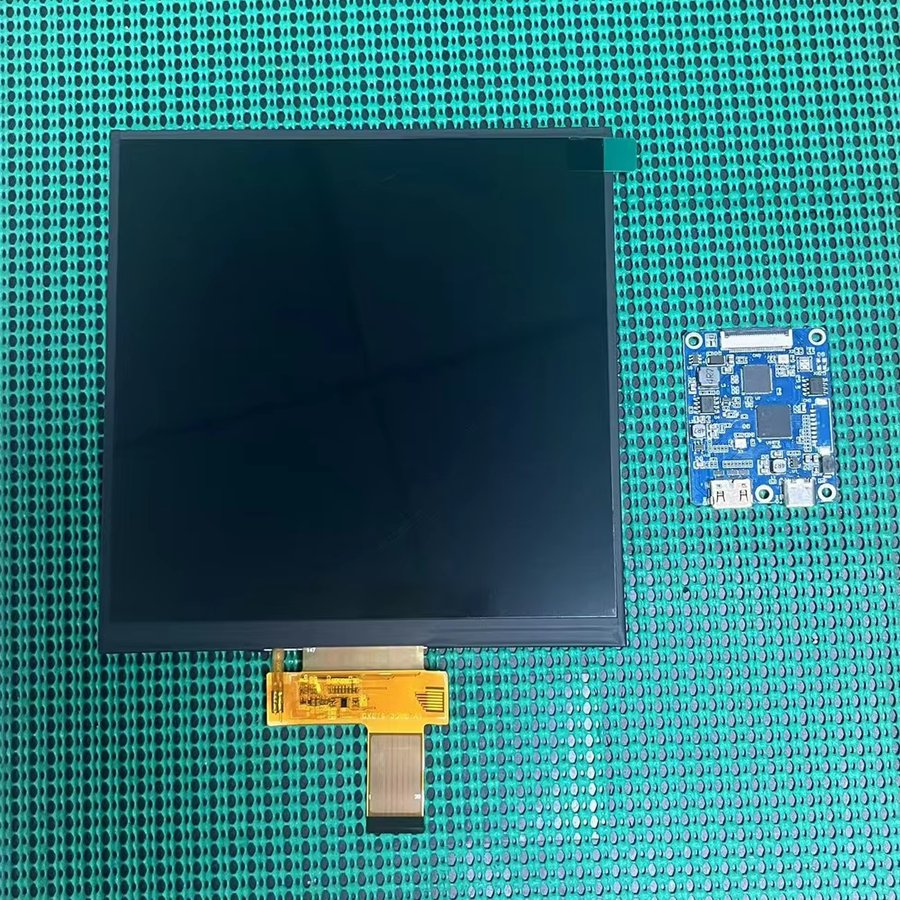
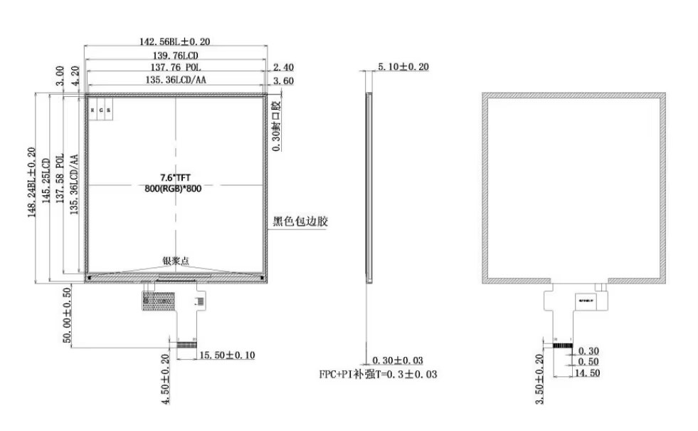

# MFD LCD — 7.6인치 정사각 IPS

Thrustmaster MFD 뒤에 겹쳐 쓰는 화면입니다. MFD 베젤의 버튼 배열이 정사각이라
일반 와이드 패널로는 화면이 남거나 잘립니다. **좌·우 각 1개씩 2개** 들어갑니다.



패널 + MIPI FPC 리본 + 드라이버 보드가 한 세트로 옵니다.
드라이버 보드에 **HDMI 입력과 USB-C 전원** 커넥터가 있어, PC 에서는 그냥 모니터 하나로 잡힙니다.

---

## 사양

| 항목 | 값 | | 항목 | 값 |
|------|-----|---|------|-----|
| 패널 | IPS (BOE) | | 해상도 | **800 × 800** |
| 화면 크기 | 7.6인치 정사각 | | 색상 수 | 16.7M |
| 표시 영역 | **135.36 × 135.36 mm** | | 밝기 | 1000 cd/m² |
| 외형 치수 | **142.56 (H) × 148.24 (V) × 5.1 (D) mm** | | 백라이트 | LED |
| 인터페이스 | MIPI | | 시야각 | 전방위 |
| 드라이버 IC | ILI9881C | | 픽셀 피치 | 36.5 (H) × 109.5 (V) |
| 장착 | PCB | | 동작 온도 | −20 ℃ ~ +70 ℃ |
| 원산지 | Guangdong, China | | 보관 온도 | −25 ℃ ~ +75 ℃ |
| 상표 | Chance | | | |

해상도 800 × 800 은 표시 영역 135.36 mm 에 대해 약 **150 ppi** 입니다.

**구매처** — [Alibaba: In Stock IPS 7.6 Inch](https://www.alibaba.com/product-detail/In-Stock-IPS-7-6-Inch_1601257654342.html)

---

## 기구 치수



| 구간 | 가로 (H) | 세로 (V) |
|------|---------|---------|
| 외형 (BL) | **142.56** ±0.20 | **148.24** ±0.20 |
| LCD | 139.76 | 145.25 |
| 편광판 (POL) | 137.76 | 137.58 |
| 표시 영역 (AA) | **135.36** | **135.36** |

두께 **5.10** ±0.20 mm.

**FPC 리본**

| 항목 | 값 |
|------|-----|
| 돌출 길이 | **50.00** ±0.50 mm (아래 방향) |
| 폭 | 15.50 ±0.10 mm |
| 보강 두께 | 0.30 ±0.03 mm (FPC + PI) |

### 홀더 설계 시 주의

**표시 영역은 정사각이지만 외형은 아닙니다.** 세로가 5.68 mm 더 깁니다.

```
가로 여백  142.56 − 135.36 =  7.20 mm
세로 여백  148.24 − 135.36 = 12.88 mm   ← 5.68 mm 더 큼
```

차이는 **FPC 가 나오는 아래쪽**에 몰려 있습니다. 표시 영역이 외형 중앙에 있지 않으므로,
MFD 창에 화면을 맞추려면 **AA 기준으로 정렬**하고 아래쪽 여유를 따로 확보해야 합니다.

리본이 아래로 **50 mm** 더 나오고 그 끝에 드라이버 보드가 붙으므로,
인클로저 안에서 패널 아래쪽에 그만큼의 공간이 필요합니다.

---

## 장착

Center 인클로저 안에서 **MFD 뒤에 겹쳐 놓기만** 하고, MFD 홀더가 둘을 함께 눌러 고정합니다.
**서로 붙이지 않습니다** — 수리할 때 홀더에서 두 장을 그대로 빼낼 수 있어야 하기 때문입니다.

```
   Thrustmaster MFD        ← 앞면 (베젤 · 버튼)
   7.6" 정사각 LCD          ← 뒤에 겹침, 접착 없음
   ─────────────────
   MFD 홀더                ← 인클로저 아래쪽에 에폭시 접착
```

`…MFDHolderUpper` 는 인클로저와 MFD 사이에 남는 빈틈을 메웁니다.
조립 순서는 [README 2-1](../README.md#2-1-조립-순서), 홀더 STL 은 [`3d stl/`](../3d%20stl/) 에 있습니다.

### 배선

LCD 는 **Teensy 와 무관합니다.** HDMI 와 USB-C 를 PC 에 직접 연결하며,
이 저장소의 펌웨어나 배선도와는 접점이 없습니다.
BMS · DCS 의 MFD 화면 출력을 이 모니터로 띄우는 방식입니다.

---

## 관련 문서

| 문서 | 내용 |
|------|------|
| [REF_PARTS.md](REF_PARTS.md) | 부품 목록 — MFD · LCD 수량 |
| [REF_LEFT_CONSOLE_WIRING.md](REF_LEFT_CONSOLE_WIRING.md) | UHF 7세그 디스플레이 — 이쪽은 Teensy 가 직접 구동하는 별개 장치 |
