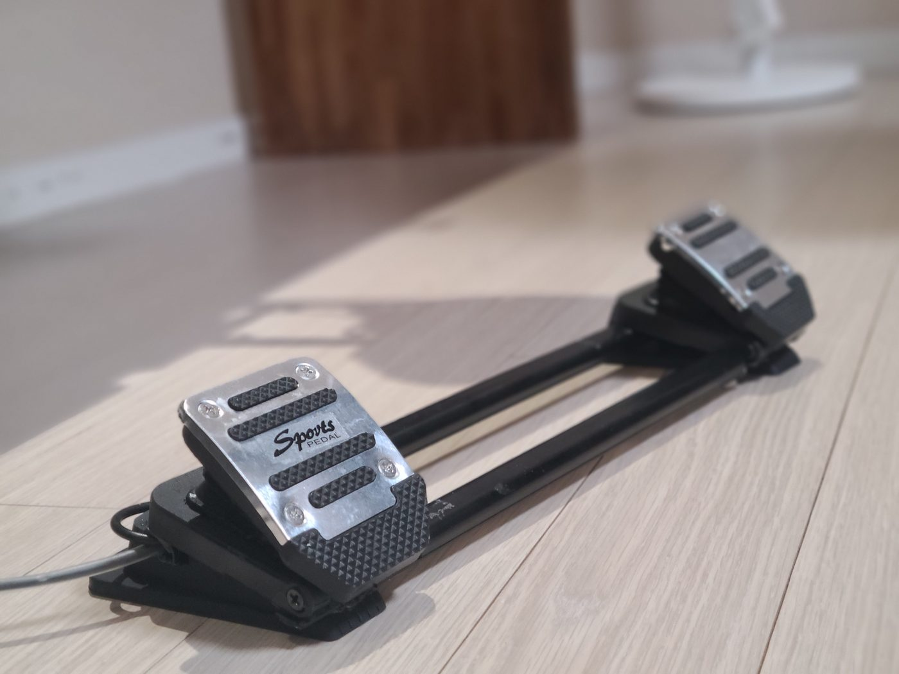
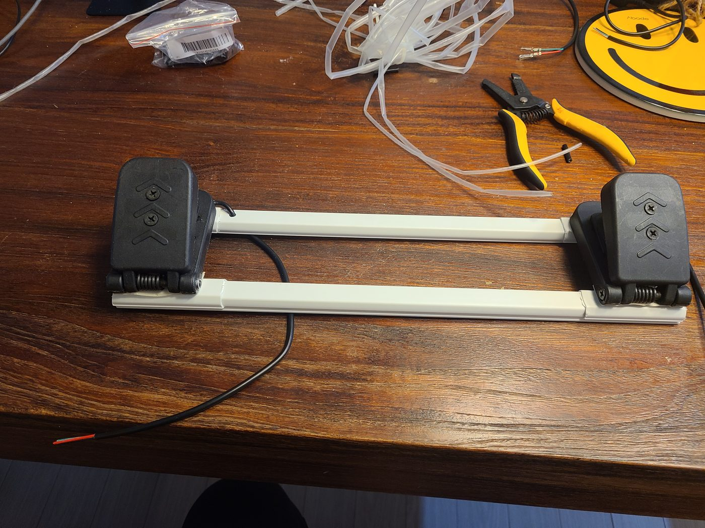
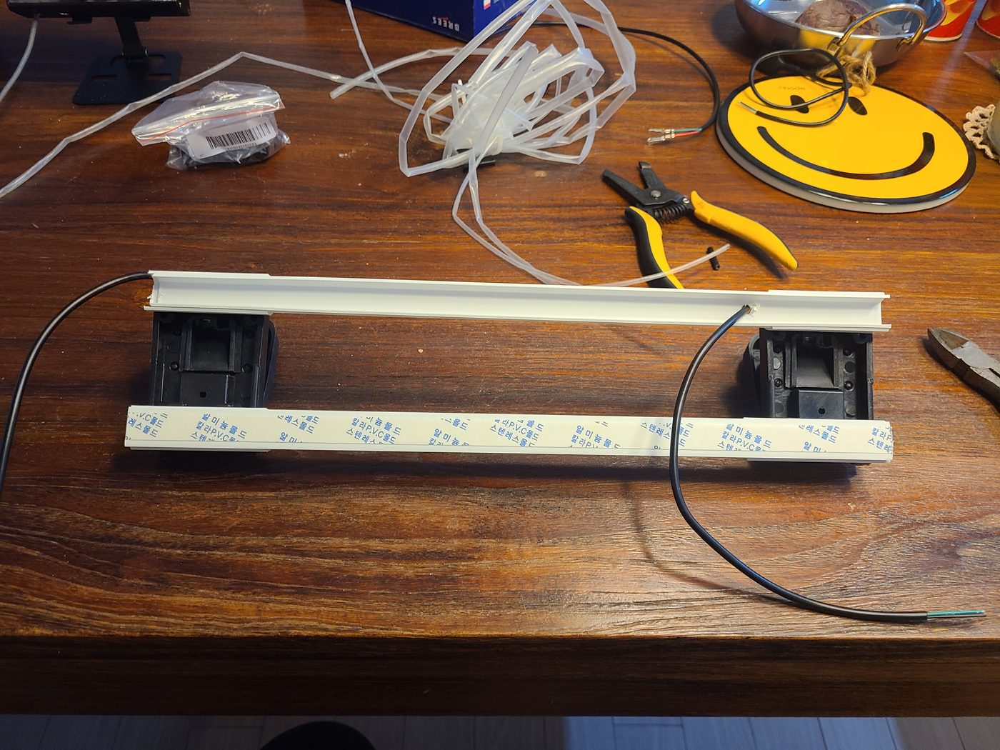
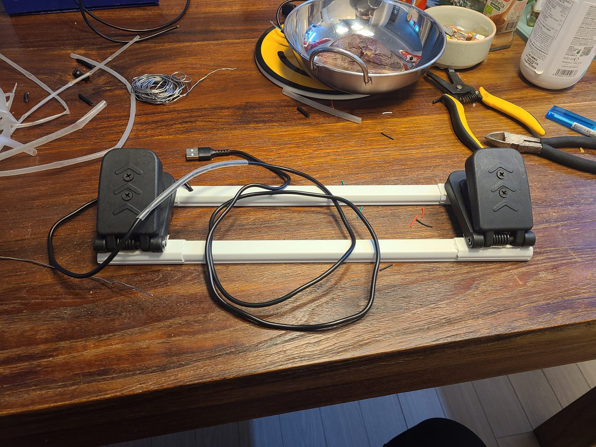

# 러더 페달 자작

홀 센서가 내장된 킥보드용 스로틀 페달 2개를 PVC 전선 몰딩에 고정한 구조입니다.
제작 당시 주요 재료비는 2만 원 미만이었습니다.



---

## 1. 구조

몰딩 두 줄을 나란히 놓고 **그 사이에 페달 2개를 서로 반대 방향으로** 물립니다.
몰딩이 곧 프레임이고, 별도 가공물이 없습니다.



페달 바닥판을 두 몰딩 사이에 끼워 고정합니다. 아래 사진은 뒷면입니다.

> 제작 사진의 흰색 몰딩은 완성 후 검정색으로 교체했습니다. 구조와 치수는 같습니다.



| 재료 | 수량 | 비고 |
|------|-----:|------|
| 전동 킥보드용 스로틀 페달 | 2 | AliExpress. **홀 센서 내장** |
| PVC 전선 몰딩 | 2 | 프레임 겸 배선 통로. **검정 권장** |
| 알루미늄 페달 커버 | 2 | AliExpress. 외관용 |

---

## 2. 센서

페달 내부 홀 센서의 아날로그 전압을 읽습니다. 센서 배선은 페달당 전원·GND·신호 3선입니다.

| 선 | 연결 |
|----|------|
| 3.3V | Teensy 3.3V |
| GND | Teensy GND |
| Signal | Teensy 아날로그 입력 |

페달이 2개이므로 **signal 2개를 각각 Teensy 에 넣습니다.**

```text
Teensy 3.3V ──┬── 페달 L VCC
              └── 페달 R VCC
Teensy GND ───┬── 페달 L GND
              └── 페달 R GND
Teensy A16(40) ─── 페달 L Signal
Teensy A17(41) ─── 페달 R Signal
```

3.3V · GND 는 두 페달이 공유하므로 `C6` 은 **신호 2선 + 전원 2선**입니다.
배선은 몰딩 안으로 통과시킵니다.



> ⚠ **5V 를 넣지 마십시오.** Teensy 4.1 아날로그 핀은 5V 톨러런트가 아닙니다.
> 홀 센서 출력이 공급 전압을 따라가므로, 5V 로 급전하면 ADC 정격을 넘겨 핀이 손상됩니다.

---

## 3. 펌웨어

`F16_LEFT_AUX_MISC.ino` 의 `processPedal()` 이 처리합니다.

| 설정 | 값 |
|------|-----|
| `PEDAL_PIN_LEFT` | `A16` |
| `PEDAL_PIN_RIGHT` | `A17` |
| `PEDAL_DEADZONE` | `300` |
| 러더 축 | `AXIS_Zr` (Zrotate) |
| 브레이크 축 | 좌 · 우 각각 |

핀은 `pinMode(..., INPUT)` 입니다 — 홀 센서가 전압을 직접 내보내므로 **풀업을 켜지 않습니다.**
(스위치류가 전부 `INPUT_PULLUP` 인 것과 다릅니다.)

### 러더 합성

두 페달 값을 하나의 축으로 합칩니다.

```c
rudder = (1023 - lb + rb) / 2
```

좌 페달을 밟으면 값이 내려가고 우 페달을 밟으면 올라갑니다. 둘 다 안 밟으면 중앙입니다.

### 브레이크 겸용

다음 중 하나면 브레이크 모드가 되어, 두 페달이 **좌 · 우 브레이크 축으로 따로** 나갑니다.

| 조건 | 설명 |
|------|------|
| 양 페달 동시 압력 | 둘 다 `PEDAL_DEADZONE`(300) 초과 |
| **Landing Light UP** | `PEDAL_BRAKE_SW_REF` — 데드존과 **무관**하게 즉시 브레이크 모드 |

브레이크 모드가 아니면 브레이크 축은 0 으로 고정됩니다.
**러더 축은 두 경우 모두 계속 출력됩니다** — 브레이크 모드라고 해서 러더가 끊기지 않습니다.

Landing Light 스위치를 브레이크 모드 선택에도 사용합니다. 게임의 비행 단계를 감지하는 것이 아니라, 물리 스위치의 LANDING 접점 상태를 읽습니다.

| 위치 | 램프 | 페달 동작 |
|------|------|-----------|
| **UP** | 이착륙 중 점등 | 데드존 **무시** — 살짝만 밟아도 브레이크. 활주로 정렬을 브레이크로 하기 때문 |
| **DOWN(TAXI)** · 중립(OFF) | TAXI 또는 소등 | 양 페달이 모두 데드존을 넘을 때 브레이크 활성 |

LANDING에서는 약한 압력도 브레이크로 출력합니다. 그 외 위치에서는 양 페달을 함께 충분히 밟아야 브레이크가 활성화됩니다.

### 자동 캘리브레이션

동작 중 최소·최대값을 계속 갱신해 0~1024 로 정규화합니다. 초기값은 `300`~`750` 입니다.
센서별 출력 차이는 동작 중 갱신한 범위로 보정합니다.

**리셋** — 양 페달을 끝까지 밟은 채 **DN LOCK REL 을 2초** 누르면 범위가 현재값으로 초기화됩니다.
완료 시 시작 점등 패턴(`welcomeCeremony`)을 실행합니다.

---

## 4. 마감

알루미늄 페달 커버를 씌우고 몰딩을 검정으로 바꿨습니다. 둘 다 기능과는 무관한 외관 작업입니다.
흰 몰딩 상태로도 동작에는 아무 차이가 없습니다.

---

## 관련 문서

| 문서 | 내용 |
|------|------|
| [REF_LEFT_AUX_WIRING.md](REF_LEFT_AUX_WIRING.md) | `C6` 케이블, 핀 배열, 축 할당 |
| [REF_PARTS.md](REF_PARTS.md) | 부품 목록 |
